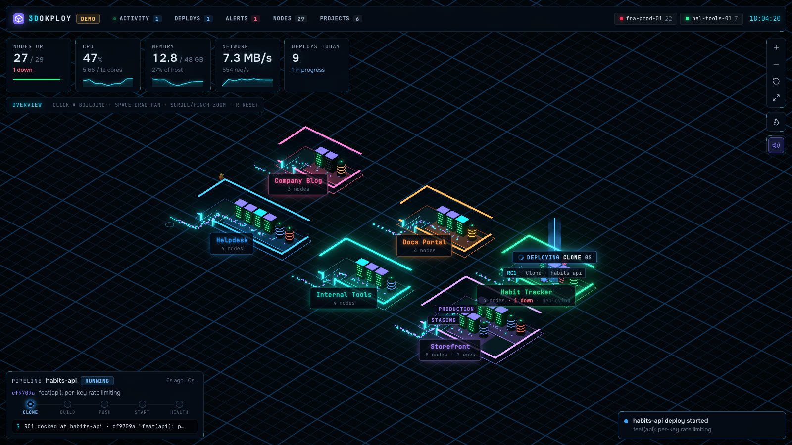

# 3Dokploy

**Your [Dokploy](https://dokploy.com) as a living, isometric server floor.** Projects become
buildings, environments become zones, services become racks and database tanks. Deploys roll in
on carts, network traffic flows in as packets, and a technician walks over to whatever goes down.



- **Live** – status, CPU, memory and network per service, deploys with their real build log,
  alerts for failed deploys and services in error, an activity feed.
- **Read-only** – 3Dokploy can't deploy, stop or change anything.
- **Self-hosted** – you run it next to your Dokploy or on your own machine. The API key stays in
  its environment and never reaches the browser.

> Not affiliated with the Dokploy project.

## Quick start

You need a Dokploy API key: create one in Dokploy under **Settings → Profile → API/CLI**.

### On your machine

Requires Node.js 22.6 or newer.

```sh
git clone https://github.com/suleyman/3dokploy.git && cd 3dokploy
cp .env.example .env.local   # set DOKPLOY_URL and DOKPLOY_API_KEY
npm install
npm run build
npm start                    # → http://localhost:3000
```

### Docker Compose

```sh
git clone https://github.com/suleyman/3dokploy.git && cd 3dokploy
cp .env.example .env         # set DOKPLOY_URL and DOKPLOY_API_KEY
docker compose up -d
```

Open <http://localhost:3000>. Dokploy itself listens on port 3000, so on the same machine set
`HOST_PORT=3100` (or any free port) in `.env`, and use `DOKPLOY_URL=http://host.docker.internal:3000`
to reach it. A prebuilt image is published to `ghcr.io/suleyman/3dokploy`.

### On Dokploy

**As a template:** `templates/dokploy/3dokploy/` holds a ready Dokploy template (compose file,
`template.toml`, metadata, logo). It points `DOKPLOY_URL` at the Dokploy on the same server and
turns on basic auth with a generated password; paste your API key into `DOKPLOY_API_KEY`.

**From the repository:** create an application from this repository with the **Dockerfile**
build type and port **3000**, set the variables below, then add a domain.

### Configuration

| Variable | Default | |
| --- | --- | --- |
| `DOKPLOY_URL` | *required* | Your Dokploy, e.g. `https://dokploy.example.com` or `http://host.docker.internal:3000` |
| `DOKPLOY_API_KEY` | *required* | A Dokploy API key. Only the server uses it. |
| `BASIC_AUTH` | – | `user:password` login for the page. Set it whenever others can reach the address. |
| `PORT` | `3000` | Port the server listens on |

Without `BASIC_AUTH`, **anyone who can open the page sees your Dokploy** (read-only, secrets
stripped). Put it behind HTTPS if it's reachable from the internet.

## Controls

| | |
| --- | --- |
| Click a building or its nameplate | Fly to the project, open its panel |
| Click a rack / tank | Select the service, open the inspector |
| `Esc` | Back out: service → project → overview |
| `Space` + drag, two-finger scroll, right/middle drag, arrow keys | Pan |
| Mouse wheel, pinch, `+` / `-` | Zoom (towards the cursor) |
| Left drag | Rotate |
| `F` / `Shift+F` / `R` | Frame the selection / fullscreen / reset the view |
| `/` | Filter nodes |
| `M` | Sound on/off |

## How it works

The UI is a React + three.js app. A small **Node.js** server (Hono, no database) serves it and
answers its Dokploy calls. Browsers can't call Dokploy directly (its API sends no CORS headers,
and the key must stay off the page), so the page calls `/api/<procedure>` on this server, which
calls the same procedure on your Dokploy with the key from its environment.

```
browser ──/api/project.all──▶ 3Dokploy server ──x-api-key──▶ your Dokploy
   └─ polling, diffing, metrics all happen here
```

- Only an **allowlist of read-only GET endpoints** is forwarded (`server/dokploy.ts`).
  Anything that changes state is refused, even with a key that could do it.
- **Secrets are stripped** from responses before they reach the browser: env vars, passwords,
  tokens, build secrets (3Dokploy never needs them).
- No database, no sessions, nothing stored. Same-origin only, with a strict Content-Security-Policy.

## Development

```sh
npm install
npm run dev        # Vite on :5173 (open this) + the API server on :3000 behind it
npm run build      # typecheck + production build into dist/
npm start          # serve dist/ and the API on :3000
```

`npm run dev` reads `DOKPLOY_URL` and `DOKPLOY_API_KEY` from `.env.local` as well.

### Layout

```
server/              read-only Dokploy API forwarding + static file server
src/data/dokploy/    Dokploy API client and the collector that polls and diffs (runs in the browser)
src/data/            types, the data source
src/layout.ts        projects → buildings, services → racks, walking routes
src/scene/           three.js scene (react-three-fiber): buildings, racks, agents, effects
src/hud/             overlay UI: top bar, menus, KPIs, inspector, pipeline
src/sound.ts         UI sounds, synthesised with Web Audio
templates/dokploy/   Dokploy template
```

### Releasing

Pushing a tag like `v0.1.0` publishes `ghcr.io/suleyman/3dokploy:0.1.0` (amd64 + arm64).
Make the package public in GitHub's package settings so others can pull it.

## Notes and limits

- Metrics come from `docker stats` on the Dokploy host (Dokploy's monitoring service isn't
  required). Services on remote Dokploy servers show status and deploys, but no metrics yet.
- `docker stats` rounds network counters, so traffic rates are estimates over a short window.
- Polling pauses while the tab is in the background.

## License

[MIT](LICENSE)
